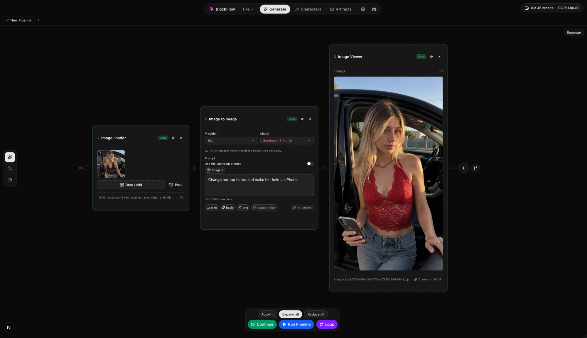

<div align="center">

# BlockFlow Studio

[](https://github.com/Hearmeman24/Blockflow-Studio/actions/workflows/ci.yml)
[](https://github.com/Hearmeman24/Blockflow-Studio/releases)
[](LICENSE)
[](https://readme.cash/c/9dg9c5wcbr)

Open source visual pipelines for AI image and video generation, with your own API keys.

Made by [HearmemanAI](https://hearmemanai.com/)



</div>

## Quickstart

You need [uv](https://docs.astral.sh/uv/getting-started/installation/),
[Node.js](https://nodejs.org/) 22.14 or newer, and git.

```bash
git clone https://github.com/Hearmeman24/Blockflow-Studio.git
cd Blockflow-Studio
uv run app.py
```

The app opens at <http://localhost:47300> and walks you through adding a key.

### Start with your AI agent

To have a coding agent do the setup instead, paste this into it:

```text
Clone https://github.com/Hearmeman24/Blockflow-Studio.git and set up BlockFlow Studio for me.
Follow the "Set up BlockFlow Studio for a user" section of AGENTS.md in the repository.
```

The full procedure is in [AGENTS.md](AGENTS.md).

## What this is

BlockFlow Studio is a local app for chaining blocks that load references,
generate images and videos, and show the results. On the **Generate** page you
build a left-to-right pipeline, for example Image Loader, then Image to Image,
then Image Viewer, and press **Run Pipeline**. Requests go to
[Kie](https://kie.ai/?ref=071ed206b70bc522e7626d3b4d1ad069) and
[PiAPI](https://piapi.ai/?ref=dbc2855b-3394-4052-8b8a-6dcc471bfced) with your
own keys, so you pay the providers directly. Generated files are saved on your
computer and listed on the **Artifacts** page.

It is forked from [BlockFlow](https://github.com/Hearmeman24/BlockFlow) and has
no RunPod or ComfyUI functionality. It is beta software: most provider paths
have so far only been tested against mocks, so expect bugs.

## Core capabilities

- **Six generation blocks:** Text to Image, Image to Image, Text to Video,
  Image to Video, Omni Reference to Video and Character Swap (replace the
  person in a video with the person from an image). A block only offers what
  your keys can run.
- **Cost before you run:** an estimate on each generation block, the
  provider's actual charge afterwards, and your balance per provider.
- **Characters:** saved faces, audio and reference files, reused across flows.
- **MCP server:** an AI agent can generate through the same app, with a cost
  cap.
- **Your own blocks:** a block is one folder, loaded automatically.

## Add your own blocks

A block is a folder with a `frontend.block.tsx` and, optionally, a
`backend.block.py`. Put yours in `private_blocks/<slug>/`, which is git-ignored,
so updates never touch it. A complete example is in
[AGENTS.md](AGENTS.md#adding-a-block). After adding or changing a block, start
the app again: `uv run app.py` rebuilds the web interface with it. While you
work on a block, `uv run app.py --dev` runs the development server instead,
which reloads your changes and shows errors in the page (it uses about 1.5 to
2 GB of memory, against about 115 MB for the built web interface).

## MCP server

The MCP server lets an AI agent list models, estimate costs and generate
through the running app; results appear on the Artifacts page. `generate`
spends your provider credits and accepts a `max_cost_usd` cap; every other tool
is free. For Claude Code, with the app running, from the repository root:

```bash
claude mcp add blockflow-studio -- uv run --directory "$(pwd)" --with "fastmcp~=4.2.3" mcp_server.py
```

If the app runs on another backend port, add
`-e BLOCKFLOW_URL=http://127.0.0.1:<port>` before `--`. For other MCP clients,
see step 5 in [AGENTS.md](AGENTS.md#set-up-blockflow-studio-for-a-user).

## Models, prices and updates

The model and provider selectors on each block show what your keys can run.
Cost estimates come from a price list bundled with the app and refreshed from
[Hearmeman24/blockflow-prices](https://github.com/Hearmeman24/blockflow-prices).
The app checks for new releases and can update a git checkout in place
(**Settings, then App**).

## Bugs

To report a bug, open an
[issue](https://github.com/Hearmeman24/Blockflow-Studio/issues/new/choose) and
attach the output of `python3 scripts/doctor.py --json`, which contains no
keys. Never paste an API key into an issue.

**Platforms.** The beta has been tested on macOS only. Windows and Linux are
supported by the code but have not been tested yet; if you try one, please
report what happens with the
[bug report template](https://github.com/Hearmeman24/Blockflow-Studio/issues/new?template=bug_report.yml).

## License

BlockFlow Studio is open source under the [MIT License](LICENSE).

You are free to use, modify, and share it, including commercially. Keep the
copyright and license notice in copies or substantial portions of the software.

For business inquiries, write to hearmeman@hearmemanai.xyz.
